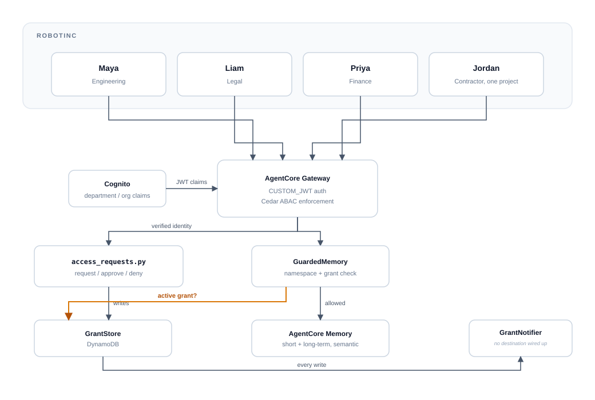

# memory-visa

> Time-boxed, human-approved, audited access across isolated AI-agent memory boundaries - built on Cedar, Cognito, DynamoDB Streams and AWS Bedrock AgentCore.

Static isolation keeps two organizations' - or two departments' - AI agents apart. It can't let them legitimately cross over on purpose, for a stated reason, for a limited time. This project is that second part: a grant store sitting on top of static isolation, not instead of it.

## What it does

1. Robotinc's departments (Engineering, Legal, Finance) each get their own AgentCore Memory namespace and toolset by default - Cedar policy and Cognito JWT claims, nothing custom.
2. When someone needs a real exception - Maya (Engineering) needs an export-control fact from Legal's files before a shipment - she calls `request_access` with a reason and a duration.
3. Legal's real domain owner (Liam) approves or denies it from his own AI client - no bespoke UI, just an MCP tool call he can already make.
4. Within the window, both the Memory namespace and that domain's toolset open up for the requester. Past it, access reverts on its own - no manual cleanup step.
5. Every transition is audited: who requested, who approved, when it expired. A DynamoDB Streams trigger is wired up to notify both the owner and the requester on each write, once a Slack webhook is configured - it isn't yet.
6. A sixth tool, `whoami`, reports a caller's own effective access live: static namespaces, any active grant, and the domain toolset that grant carries.

The same workflow covers a narrower starting point too: Jordan, a contractor, external, scoped to one project, no department claim at all (`tests/eval_rbac_isolation.py::test_eval5`).

## Architecture



Cedar policies and Cognito JWT claims handle static org/department isolation - that's standard AgentCore. The addition here is `GrantStore`, an external entitlements store backing that same Cedar ABAC, rather than AgentCore's [Dogwood](https://docs.aws.amazon.com/bedrock-agentcore/latest/devguide/policy-temporal.html) temporal policies - Dogwood's session history is scoped to one caller, so it can't model a two-person approval (requester and approver).

## Status

Offline, `make eval` runs six properties end to end against fakes: cross-org isolation, within-org silo enforcement, legitimate cross-team flow, credential/PII scrubbing, and the full grant lifecycle for both an employee and a contractor whose default access starts narrower.

Deployed in the sandbox account, `eu-west-2`:

| Resource | Status | Notes |
|---|---|---|
| VPC + flow logs | live | |
| Bedrock Guardrail | live | regex secret redaction + PII |
| Cognito pool + domain | live | custom `department`/`org` claims, both OAuth flows configured |
| AgentCore PolicyEngine | `ACTIVE` | one `permit` baseline, one `forbid` kept at `LOG_ONLY` (see below) |
| AgentCore Gateway | `READY` | `CUSTOM_JWT` auth; `IdentityInterceptor` resolves real Cognito identity before every tool call |
| EngineeringTools target | `READY`, gate inert | `check_shipping_classification`'s department gate can't fire - Cognito access tokens carry no custom attributes, so `hasTag("department")` is never true. Left at `LOG_ONLY` rather than claim a gate that doesn't hold |
| AccessRequestTools target | `READY` | six MCP tools (`request_access`, `approve_access`, `whoami`, etc.), one Lambda, state in DynamoDB |
| GrantNotifier | `READY`, not wired up | Lambda + DynamoDB Streams trigger fire on every grant write, but `/memory-visa/slack-webhook-url` was never set - nothing is delivered yet |
| AgentCore Memory | `ACTIVE` | pool-tenancy, one semantic strategy, 31-day record expiry |
| AgentCore Runtime | `READY` | `network_mode="PUBLIC"` (no NAT gateway in this stack) |

**Known gaps:**
- The orchestrator's own Gateway target reads identity from claims in the request body, not the verified JWT - the six MCP tools don't have this gap, since `IdentityInterceptor` resolves real identity for those.
- The DynamoDB grant store is an append-only table queried by `grant_id`, not a single `audit_log` attribute like the in-memory version.

## Quickstart

<details>
<summary><strong>1. Offline proof</strong> - no AWS account needed</summary>

```bash
git clone https://github.com/jakesky45/memory-visa.git && cd memory-visa
cd cdk && python3 -m venv .venv && source .venv/bin/activate && pip install -r requirements.txt pytest
cd .. && make eval
```

</details>

<details>
<summary><strong>2. Deploy the live stack</strong> - real, billed AWS infrastructure</summary>

```bash
cd cdk && source .venv/bin/activate
cdk deploy MemoryVisaAgentCore --require-approval never
```

</details>

<details>
<summary><strong>3. Give yourself a real Cognito login and call it as a person</strong></summary>

```bash
USER_POOL_ID=$(aws ssm get-parameter --name /memory-visa/user-pool-id --query Parameter.Value --output text)
USER_CLIENT_ID=$(aws ssm get-parameter --name /memory-visa/user-client-id --query Parameter.Value --output text)
GATEWAY_URL=$(aws ssm get-parameter --name /memory-visa/gateway-url --query Parameter.Value --output text)

aws cognito-idp admin-set-user-password --user-pool-id "$USER_POOL_ID" \
  --username maya --password '<temporary-password>' --permanent

TOKEN=$(aws cognito-idp initiate-auth --client-id "$USER_CLIENT_ID" --auth-flow USER_PASSWORD_AUTH \
  --auth-parameters USERNAME=maya,PASSWORD='<temporary-password>' \
  --query AuthenticationResult.AccessToken --output text)

curl -s -X POST "$GATEWAY_URL/mcp" -H "Authorization: Bearer $TOKEN" \
  -H "Content-Type: application/json" -H "Accept: application/json, text/event-stream" \
  -d '{"jsonrpc":"2.0","id":1,"method":"tools/list","params":{}}' \
  | sed -n 's/^data: //p' | jq -r '.result.tools[].name'
```

Same for `liam` and `priya` - `CfnUserPoolUser` can't set a password declaratively, so that one step is manual for each.

</details>

## Repo layout

| Path | What's there |
|---|---|
| `src/memory/grants.py` | the entitlements store, in-process |
| `src/memory/grants_dynamodb.py` | same interface, DynamoDB-backed - what the MCP tools actually use |
| `src/memory/guarded_memory.py` | the RBAC gate |
| `src/memory/agentcore_backend.py` | the real AgentCore Memory client |
| `src/agents/domain_config.py` | per-role toolset, grant-aware |
| `src/agents/domain_owners.py` | per-org approval authority |
| `src/agents/access_requests.py` | request/approve/deny logic, shared by the orchestrator and the MCP tools |
| `src/tools/identity_interceptor.py` | resolves a caller's real Cognito identity before any tool runs |
| `src/tools/access_request_tools.py` | `request_access`/`list_pending`/`approve_access`/`deny_access`/`revoke_access`/`whoami` as six MCP tools |
| `src/tools/grant_notifier.py` | DynamoDB Streams → Slack, both directions |
| `src/tools/check_shipping_classification_tool.py` | the one real Engineering Gateway tool, a stub |
| `src/server.py` | the orchestrator: `/ping`, `/invocations`, routes through the modules above |
| `tests/` | the eval suite - runs the six properties offline, no AWS account needed |
| `cdk/` | network, guardrails, and agentcore CDK stacks |
| `Dockerfile` | the orchestrator's container image (arm64, `PYTHONUNBUFFERED=1`) |
| `Makefile` | `make eval` |

## What's next

Memory is only as fresh as the last explicit `put()`. Nothing here tails a real system of record, so a fact doesn't get corrected if the underlying classification changes later - the 31-day record expiry just lets old facts drop out eventually.
