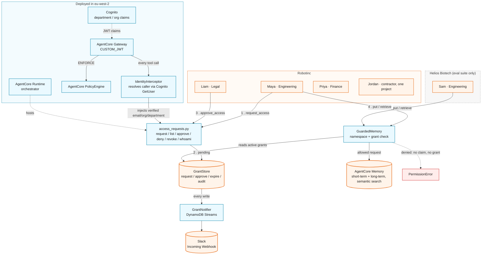

# memory-visa

> Time-boxed, human-approved, audited access across isolated AI-agent memory boundaries - built on Cedar, Cognito, DynamoDB Streams and AWS Bedrock AgentCore.

Static isolation keeps two organizations' - or two departments' - AI agents apart. It can't let them legitimately cross over on purpose, for a stated reason, for a limited time. This project is that second part: a grant store sitting on top of static isolation, not instead of it.

## What it does

1. Robotinc's departments (Engineering, Legal, Finance) each get their own AgentCore Memory namespace and toolset by default - Cedar policy and Cognito JWT claims, nothing custom.
2. When someone needs a real exception - Maya (Engineering) needs an export-control fact from Legal's files before a shipment - she calls `request_access` with a reason and a duration.
3. Legal's real domain owner (Liam) approves or denies it from his own AI client - no bespoke UI, just an MCP tool call he can already make.
4. Within the window, both the Memory namespace and that domain's toolset open up for the requester. Past it, access reverts on its own - no manual cleanup step.
5. Every transition is audited: who requested, who approved, when it expired. A DynamoDB Streams trigger posts a notification on every write, in both directions - the owner hears there's something pending, the requester hears the outcome.
6. A sixth tool, `whoami`, reports any caller's own effective access live: static namespaces, any active grant, and the domain toolset that grant carries.

A contractor case proves the same mechanism holds for a narrower starting point: Jordan, external, scoped to one project, no department claim at all, goes through the identical grant workflow (`tests/eval_rbac_isolation.py::test_eval5`).

## Architecture



Static org/department isolation is the floor. Cedar policies and JWT claims handle it cleanly - that part is standard. The grant on top is what this repo contributes: an **external entitlements store** (`GrantStore`) backing ordinary Cedar ABAC, deliberately not built on AgentCore's Dogwood temporal policies.

That was a near-miss worth recording. Dogwood's session history is scoped to one caller's own session - confirmed against AWS's own docs, two different principals supplying the same session ID get isolated histories. It can answer "did I call RunTests before Deploy." It cannot answer "did a different person approve something that unlocks my request." A grant is inherently cross-person, so it stays outside Dogwood, as an external store.

## What's actually true right now

**Proven, not just written.** `make eval` runs six properties end to end against fakes, no live AWS needed: cross-org isolation, within-org silo enforcement, legitimate cross-team flow, credential/PII scrubbing, the full grant lifecycle for an employee (deny, request, approve, succeed within window, expire, deny again - audit trail intact throughout), and the same lifecycle for a contractor whose default access is narrower still.

**Deployed and verified live** in the sandbox account, `eu-west-2`:

| Resource | Status | Notes |
|---|---|---|
| VPC + flow logs | live | |
| Bedrock Guardrail | live | regex secret redaction + PII |
| Cognito pool + domain | live | custom `department`/`org` claims, `client_credentials` OAuth flow for the shared service token, `authorization_code` OAuth configured for per-user clients, a real `/oauth2/token` endpoint |
| AgentCore PolicyEngine | `ACTIVE` | one `permit` (baseline: any authenticated caller can reach a known action), one `forbid` kept at `LOG_ONLY` - see below |
| AgentCore Gateway | `READY` | `CUSTOM_JWT` auth, an `IdentityInterceptor` Lambda resolving every caller's real Cognito identity (email, org, department) before a tool ever runs |
| EngineeringTools target | `READY` | one real tool, `check_shipping_classification` - a stub, meant to be gated by the `engineering` department tag. Its policy is deliberately `LOG_ONLY`: promoting it to `ACTIVE` was tested live and denied *everyone*, including engineering callers, because the Gateway's `CUSTOM_JWT` authorizer only ever sees Cognito access tokens, which carry no custom attributes - `principal.hasTag("department")` can never be true on this auth path. Reported honestly as inert rather than left claiming a gate that doesn't hold. Not wired to `GrantStore` either way |
| AccessRequestTools target + DynamoDB | `READY` | six real, individually-discoverable MCP tools backed by one Lambda: `request_access`, `list_pending`, `approve_access`, `deny_access`, `revoke_access`, and `whoami` (reports a caller's own effective access live). State lives in DynamoDB, not the orchestrator's in-process `GrantStore`, since separate `tools/call` invocations share no Python process. Confirmed live: a real `tools/list` shows all six tools with their schemas; the full request → approve round trip works for both an employee and a contractor starting from a narrower default; three different tokens tried against the same pending grant got exactly the enforcement the code promises (two rejected with the real `NotDomainOwnerError` text, one succeeded); the approved grant sits in the real DynamoDB table, confirmed with a direct `scan` |
| GrantNotifier + DynamoDB Streams | `READY` | fires on every grant write (not just creation) and posts to Slack via an Incoming Webhook - a `pending` write nudges the real domain owner with the exact command to approve or deny it; an `approved`/`denied` write tells the requester the outcome, closing a gap that used to leave them with silence either way. Confirmed live in both directions |
| AgentCore Memory | `ACTIVE` | pool-tenancy, one semantic strategy, 31-day record expiry. A real `put` → background extraction → `retrieve` round trip is confirmed working live, after fixing two bugs: `MemoryExecutionRole` had no permission to invoke the Bedrock model extraction depends on (every extraction attempt failed silently), and extraction filed records under AWS's default namespace template while this code queries the plain namespace string directly (two paths that never intersected). Both fixed; see `cdk/stacks/agentcore_stack.py` for the detail |
| AgentCore Runtime | `READY`, confirmed working live both directly and through the gateway | The earlier 502 was `network_mode="VPC"` with no NAT gateway in this stack (a deliberate cost decision elsewhere) - no outbound route for the container to reach ECR or the Memory API at all. Fixed by switching to `network_mode="PUBLIC"`, AgentCore's own default, since network-level isolation was never this project's actual security boundary anyway (IAM, Cognito, Cedar, and `GuardedMemory` are) |

**Not yet true.** Identity into the orchestrator (the `Orchestrator` Gateway target, HTTP passthrough) is still explicit claims in the request body, not a verified JWT - the Gateway's `CUSTOM_JWT` auth validates the *caller*, but the orchestrator doesn't yet read department/org claims back out of that verified token itself. The six MCP tools don't have this problem: `IdentityInterceptor` resolves every caller's real identity from Cognito before the tool ever runs, and a call with no verified email fails outright. The DynamoDB-backed grant store also doesn't replicate the in-memory `GrantStore`'s full audit-trail list (`audit_log`) as a single attribute - it's a separate append-only table, queried by `grant_id`, not an in-process list; the eval suite's in-memory version is still the one that proves the audit-trail property directly.

## Quickstart

<details>
<summary><strong>1. Offline proof</strong> - no AWS account needed</summary>

```bash
git clone https://github.com/jakesky45/memory-visa.git && cd memory-visa
cd cdk && python3 -m venv .venv && source .venv/bin/activate && pip install -r requirements.txt pytest
cd .. && make eval
```

</details>

<details>
<summary><strong>2. Deploy the live stack</strong> - real, billed AWS infrastructure</summary>

```bash
cd cdk && source .venv/bin/activate
cdk deploy MemoryVisaAgentCore --require-approval never
```

</details>

<details>
<summary><strong>3. Give yourself a real Cognito login and call it as a person</strong></summary>

```bash
USER_POOL_ID=$(aws ssm get-parameter --name /memory-visa/user-pool-id --query Parameter.Value --output text)
USER_CLIENT_ID=$(aws ssm get-parameter --name /memory-visa/user-client-id --query Parameter.Value --output text)
GATEWAY_URL=$(aws ssm get-parameter --name /memory-visa/gateway-url --query Parameter.Value --output text)

aws cognito-idp admin-set-user-password --user-pool-id "$USER_POOL_ID" \
  --username maya --password '<temporary-password>' --permanent

TOKEN=$(aws cognito-idp initiate-auth --client-id "$USER_CLIENT_ID" --auth-flow USER_PASSWORD_AUTH \
  --auth-parameters USERNAME=maya,PASSWORD='<temporary-password>' \
  --query AuthenticationResult.AccessToken --output text)

curl -s -X POST "$GATEWAY_URL/mcp" -H "Authorization: Bearer $TOKEN" \
  -H "Content-Type: application/json" -H "Accept: application/json, text/event-stream" \
  -d '{"jsonrpc":"2.0","id":1,"method":"tools/list","params":{}}' \
  | sed -n 's/^data: //p' | jq -r '.result.tools[].name'
```

Same for `liam` and `priya` - `CfnUserPoolUser` can't set a password declaratively, so that one step is manual for each.

</details>

## Repo layout

```
src/memory/      grants.py (the entitlements store, in-process), grants_dynamodb.py (the same
                 interface, DynamoDB-backed - what the MCP tools actually use), guarded_memory.py
                 (the RBAC gate), agentcore_backend.py (the real AgentCore Memory client)
src/agents/      domain_config.py (per-role toolset, grant-aware), domain_owners.py (per-org
                 approval authority), access_requests.py (the request/approve/deny logic, shared
                 by the orchestrator and the MCP tools)
src/tools/       identity_interceptor.py (resolves a caller's real Cognito identity before any
                 tool runs), access_request_tools.py (request_access/list_pending/approve_access/
                 deny_access/revoke_access/whoami as six individually-discoverable MCP tools),
                 grant_notifier.py (DynamoDB Streams -> Slack, both directions),
                 check_shipping_classification_tool.py (the one real Engineering Gateway tool,
                 a stub)
src/server.py    the orchestrator: /ping, /invocations, routes through the modules above
tests/           the eval suite - the actual proof
cdk/             network, guardrails, and agentcore stacks. Every property name here was verified
                 by introspecting the real SDK or a live deploy error, not guessed
Dockerfile       the orchestrator's container image (arm64, PYTHONUNBUFFERED=1 - a long-running
                 Python process otherwise buffers stdout and never actually logs anything)
Makefile         make eval
```

## What's next

The main open gap is content staleness, not infrastructure: Memory is only as fresh as the last explicit `put()`. Nothing here tails a real system of record or re-asserts a fact if the underlying classification later changes - the 31-day record expiry forces old facts to eventually drop out, but that's an expiry, not a correction.
