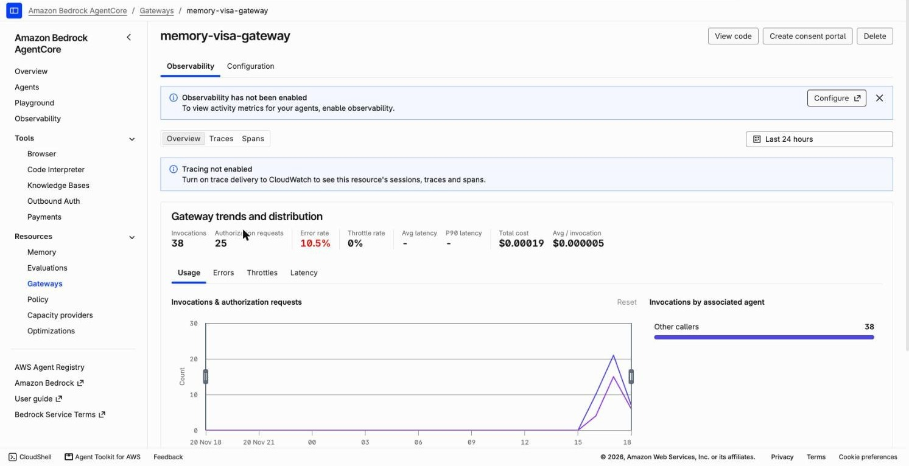
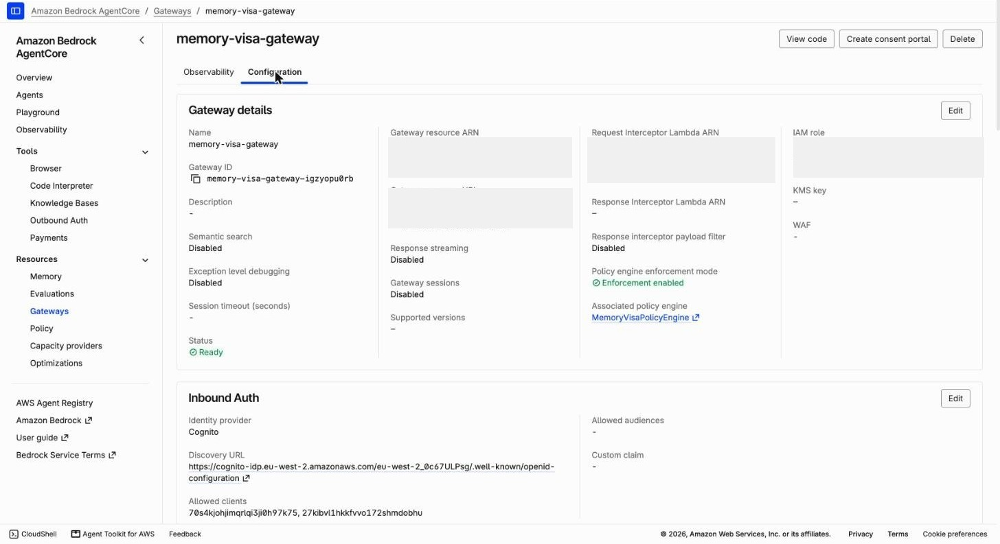
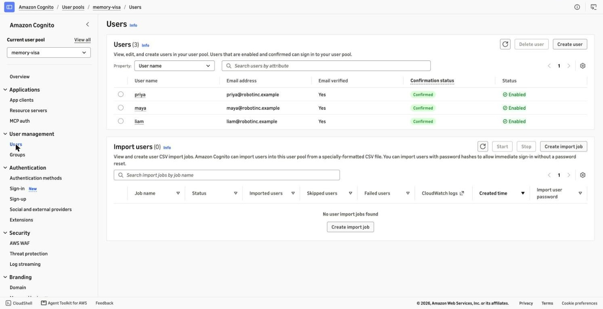
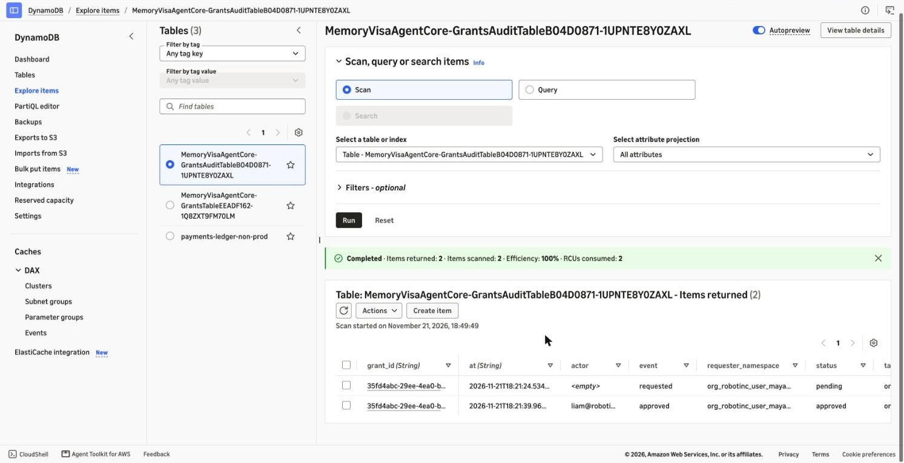

# Cross-Domain Access Grants on Bedrock AgentCore

*memory-visa: Deliberate, temporary, human-approved access across internal AI agent boundaries.*

> 📦 Repo: [github.com/jakesky45/memory-visa](https://github.com/jakesky45/memory-visa) - CDK infrastructure, Cedar policies, MCP tool implementations, and an offline `make eval` suite you can run without an AWS account.

Three days before the Atlas-v2 ships, Maya hits a wall.

She's in Engineering at Robotinc. Her packaging manifest needs one specific fact from Legal's files: an export-control classification. She doesn't have access to it - it's Legal's domain, and for good reason most days of the year.

This is the actual test of any access-control system, and it's a more interesting one than "can I keep people out." Anyone can lock a door. The hard version is: can I let the right person in, on purpose, for a stated reason, for exactly as long as it takes, without leaving the door open behind them? Can I prove, afterward, exactly who let them in and why?

AWS Bedrock AgentCore already ships the "keep people out" half: Cedar policies, Cognito JWT claims, and per-tenant namespace isolation in Memory. It's solid and already shipped, so none of that gets reinvented here. What it doesn't ship is Maya's situation: a deliberate, temporary, audited crossing of a boundary that's supposed to hold every other day of the year.

That's the part memory-visa builds. Here we're exploring how this could look in practice, using some of AWS's own native tools rather than bolting on new infrastructure.

## Why Share Memory At All

If you're running more than one AI agent across your org, which most teams past a certain size already are, each agent's memory is usually its own island. Engineering's agent learns things Legal's agent will never see. Finance's agent starts from zero on a question Engineering already answered last quarter. Centralise that memory - one shared, namespaced store instead of five disconnected ones - and the payoff compounds: any agent can draw on what any other agent in the org already knows, not just its own slice.

The catch shows up the moment you actually try it. Centralised means every agent can now see everything, which is worse than the islands you started with - that's not a hypothetical, it's the first thing that breaks. memory-visa is the piece in between: shared by default stays isolated by default, and crossing that boundary is a deliberate, audited, time-boxed act, not a permanent hole knocked in the wall.

None of this requires standardising on one AI client, either. MCP means Maya keeps using Claude, Liam can be on Cursor, Priya on whatever ships next year - they're all calling the same tools behind the same Gateway, into the same memory. Bring your own agent; the memory and the access control are centralised, not the tool everyone's forced to open.

## The Problem, Inside One Company

Robotinc ships the Atlas-v2, their new warehouse robot. Four people, four defaults:

```
Robotinc
 +-- Maya   (Engineering)
 +-- Liam   (Legal)
 +-- Priya  (Finance)
 `-- Jordan (Contractor - external, scoped to one project, no department at all)
```

The first three each see only their own department's memory and tools, nobody else's - correctly, on an ordinary day. Jordan starts narrower still, the way a contractor's access should look from day one rather than something retrofitted after the fact.

Today isn't an ordinary day for Maya - and "ask Liam to paste it into Slack" isn't an audit trail.

| Requirement | Failure mode if unmet |
|---|---|
| Department isolation | Maya reads Priya's confidential Q4 budget notes by accident, because nothing actually stops Engineering from reading Finance's notes. |
| Controlled cross-domain access | Maya needs Liam's classification before the shipment goes out. Permanent isolation makes that impossible; no isolation makes row one pointless. |

The same mechanism covers Jordan's trickier case too: when he needs an exception, he goes through the exact same grant workflow Maya does. Contractors should get the tightest defaults and the most audited exceptions - full-time status shouldn't be the baseline everyone starts from.

## Getting on the Same Page

If you're opening the repo for the first time, here is how the pieces fit together:

| Term | What it is |
|---|---|
| **Bedrock AgentCore** | AWS's managed runtime for AI agents. A **Gateway** fronts your tools behind one authenticated endpoint; **Memory** holds agent memory, namespaced per tenant, in two tiers - **short-term** (the raw event, written and readable immediately) and **long-term** (facts automatically extracted from short-term memory by a background process, searchable only once that extraction finishes); a **Policy Engine** evaluates access rules before a request reaches your code at all. |
| **Cedar** | The policy language AWS open-sourced for exactly this - `permit`/`forbid` statements over principal, action, and resource, default-deny, evaluated by the Policy Engine. |
| **Cognito** | The identity provider. Every caller authenticates here first; org and department claims ride along as JWT claims, which Cedar reads as tags on the principal, not plain attributes. |
| **MCP (Model Context Protocol)** | The open protocol an AI client uses to discover and call tools. `tools/list` says what's callable; `tools/call` invokes one. Client-agnostic by design - that's what makes bring-your-own-client possible at all. |
| **Gateway Target** | What the Gateway actually forwards a call to - a Lambda function, an HTTP endpoint, or another AgentCore Runtime. A target's real tools are what Cedar's own schema validates actions against. |

Put together, every call takes the same path regardless of which tool it's actually reaching for:

```
[ AI Client: Claude / Cursor / Kiro ]
                 |
                 v  (MCP tools/call + Cognito JWT)
+-----------------------------------------+
|            AgentCore Gateway            |
|  +-----------------------------------+  |
|  |  Policy Engine (Cedar Evaluation) |  |
|  +-----------------------------------+  |
+-----------------------------------------+
                 |
                 v  (Authorised requests only)
[ Gateway Target: Lambda / HTTP / Runtime ]
```

## What AgentCore Ships, and Where It Stops

Before building a custom grant store, the obvious question is whether AgentCore already handles time-boxed access out of the box. It comes close: AWS ships [Dogwood](https://docs.aws.amazon.com/bedrock-agentcore/latest/devguide/policy-temporal.html), a stateful extension to Cedar that lets policies reason over session history ([authoring guide](https://docs.aws.amazon.com/bedrock-agentcore/latest/devguide/policy-temporal-authoring.html); good background on the policy-session mechanics in [sph.sh's writeup](https://sph.sh/en/posts/dogwood-temporal-policy-language/) and a practical walkthrough at [subagentic.ai](https://subagentic.ai/howtos/how-to-write-your-first-temporal-policy-agentcore-dogwood/)).

Confirmed against AWS's docs, the catch is that Dogwood's history is strictly single-caller: even if two people pass the exact same session ID, AgentCore isolates their histories by principal.

- What it solves: "Did Maya call RunTests before calling Deploy?" One person, one session.
- What it can't see: "Did Liam approve a grant unlocking Legal's files for Maya?" Two people, two separate sessions.

An access grant is inherently a two-person handshake - one person asks, someone else approves. Because Dogwood can't look across callers, no amount of policy configuration will make it hold an approval.

That's why the grant lives in its own external table, `GrantStore`, backing ordinary Cedar ABAC. Static Cedar policies and JWT claims still enforce the baseline walls, unchanged; `GrantStore` sits on top as an audited exception layer for when someone needs to cross them.

## The Lifecycle

Request, approve, use within the window, expire automatically, audit trail throughout. No manual cleanup step: expiry is checked lazily, the next time anyone asks rather than on a cron.

```
1. Maya requests access into Legal's domain (with a reason)
       |
       v
2. GrantStore: PENDING (waiting on Liam)
       |
       v
3. Liam approves -----> Time-boxed window opens
       |
       v
4. Maya's namespace opens for the window -----> Closes automatically
```

No grant, no access. Approved or not, it's always Liam's call to make, and it always expires on its own.

## What a Grant Actually Unlocks (And a Bug We Caught Testing It)

Scoped precisely: what a grant opens today is Memory - `put`/`retrieve` into the target namespace, nothing more. Robotinc also has one real department-scoped tool behind the Gateway, Engineering's `check_shipping_classification` (a stub that looks up a shipment's export-control status). Testing it live turned up a real bug, not just a gap:

1. A Cedar policy exists to gate it by the caller's `department` tag, but it was sitting in `LOG_ONLY` mode - evaluating and logging, never actually blocking anyone.
2. Promoting it to `ACTIVE` to check denied *everyone*, including Maya in Engineering, not just Liam in Legal.
3. The reason: the Gateway's `CUSTOM_JWT` authorizer only ever validates Cognito access tokens, and access tokens carry no custom attributes at all - the same reason `IdentityInterceptor` has to call Cognito's `GetUser` separately, back in the identity section below. `principal.hasTag("department")` can therefore never be true, so the policy's exception could never have fired for anyone, in any deployment.

It's back in `LOG_ONLY` now, reported honestly as such rather than left claiming a gate that doesn't work. `GrantStore` never touched this policy either way - that part was true all along.

That's one tool, and it turned out to be effectively unenforced. Separately, the project's own toolset model is grant-aware by design and actually works as built - a grant into a domain carries that domain's whole toolset alongside its Memory namespace, not Memory alone:

| Department | Tools | Who has them with no grant |
|---|---|---|
| Engineering | `check_shipping_classification`, `generate_packaging_manifest`, `query_firmware_specs` | Maya |
| Legal | `search_contracts`, `check_export_control`, `log_compliance_note` | Liam |
| Finance | `query_budget`, `query_ma_targets` | Priya |

`allowed_tools()` (`src/agents/domain_config.py`) computes this live from the same claims and grant store every other check in this post relies on, confirmed two ways: the eval suite's own assertions offline, and a live `whoami` call (below) showing Jordan picking up all three Engineering tools the moment his grant into Engineering was active, then losing them again the moment it expired. None of that reaches the one real deployed Gateway tool from the paragraph above, though - `check_shipping_classification` exists only behind `EngineeringTools`, its own gating currently inert, with no connection to this table at all. Two tool models, deliberately not merged: one proven offline and grant-aware and confirmed working live, one live and currently ungated.

## Maya Gets Her Fact

Memory access is the thing a grant actually opens - worth showing working, not just asserted, same as everything else in this post. It wasn't working, at first, for two reasons that have nothing to do with grants or Cedar:

1. `MemoryExecutionRole` - the role AgentCore Memory assumes to run semantic extraction - had a trust policy and nothing else. No permission to invoke the Bedrock model extraction depends on. Every extraction attempt failed silently; a `retrieve` always came back empty, indistinguishable from "extraction hasn't finished yet."
2. Fixing that uncovered a second issue: extraction filed records under AWS's default namespace template (`/strategies/{strategyId}/actors/{actorId}/`), while this project's `retrieve()` queries the plain namespace string directly (`org_robotinc_dept_legal`). Two paths that never intersected. Overriding the strategy's namespace to `{actorId}` fixed it without touching a line of application code.

Put and retrieve aren't MCP tools - that's Tier One, the HTTP passthrough target from earlier, invoked directly rather than discovered via `tools/list`. With both bugs fixed, here's the actual scenario from the top of this post, run for real. Liam writes the fact Maya needs:

```json
{"action": "put", "namespace": "org_robotinc_dept_legal",
 "text": "The X-7 battery pack is classified under export control code 7A994 and requires an export licence before international shipment."}
```
```json
{"ok": true, "result": {"namespace": "org_robotinc_dept_legal", "eventId": "0000001795364012656#508fa195"}}
```

A minute or so later - real background extraction, not an instant write - Maya, holding the grant from earlier in this post, retrieves:

```json
{"action": "retrieve", "namespace": "org_robotinc_dept_legal",
 "query": "X-7 battery pack export control classification"}
```
```json
{"ok": true, "result": [
  {"text": "The X-7 battery pack is classified under export control code 7A994 and requires an export licence before international shipment."},
  {"text": "Supplier X is banned under export control classification 7A994 effective immediately (as of 2026-11-22)."}
]}
```

That first result is the fact from paragraph one. Maya's packaging manifest has what it needs, three days before the Atlas-v2 ships - and the audit log backing it now records who asked, which namespace, and what they searched for, not just that some request happened:

```json
{"email": "maya@robotinc.example", "org": "robotinc", "departments": ["engineering"], "action": "retrieve", "namespace": "org_robotinc_dept_legal", "at": "2026-11-22T16:17:46Z", "query": "X-7 battery pack export control classification"}
```

That `email` and `query` field didn't exist until this round trip forced the question - the log line used to carry neither, and its own `print()` calls were sitting in an unflushed stdout buffer regardless, a standard gotcha for a long-running, non-interactive Python process, fixed with `PYTHONUNBUFFERED=1`.

One honest caveat on how this demo is invoked, not papered over: Tier One takes `claims` directly in its request body - org, department, email - not a verified JWT. That's a narrower guarantee than everywhere else in this post. Cognito authenticates the *call* to the Gateway, but the orchestrator doesn't yet read department or org back out of that verified token itself - the same gap the code's own docstring names. The grant-and-tool layer (`request_access` through `whoami`) never has this problem; identity there comes from `IdentityInterceptor`'s token resolution, never the caller. Memory access through Tier One is the one place in this post where that's not yet true.

## Six Properties, Proven Offline

Six properties are proven end-to-end, offline, with no live AWS needed (`make eval`):

1. Cross-org isolation
2. Within-org silo enforcement
3. Legitimate cross-team flow
4. Credential and PII scrubbing
5. The full grant lifecycle for an employee
6. The same lifecycle for a contractor with a narrower default

That's the test suite doing the actual arguing, not a slide.

## Getting the Approval Out of a Bespoke UI

A grant with nobody to approve it is just a request queue. The obvious answer is a Slack app with a real Approve/Deny button - but that needs an interactivity endpoint, signature verification, and its own identity-trust story (whose Slack account counts as "really Liam"?), which is a second, parallel security model next to the Cognito-verified one this whole post is about. Worth building later, maybe; not worth bolting onto a post arguing for *fewer* bespoke surfaces, not more.

The approver already has an AI client open - Claude, Cursor, Kiro, whatever they already reach for. MCP doesn't care which. Bring-your-own-client is the whole point of the protocol, built into the standard rather than bolted on for this project. If `approve_access` is a real tool that client can see and call, the approval step costs nothing extra to operate - no new surface, no new login, no admin request to file.

That's two different levels of "real," though, and only one of them is good enough:

- **Tier One (HTTP Passthrough)** - the orchestrator fronted by the Gateway as an `http.agentcoreRuntime` passthrough target. Confirmed working end-to-end with a real OAuth token: client credentials, Cognito, bearer token, Gateway, Cedar, a real `InvokeAgentRuntime`, and a real Memory write. But it's passthrough. A real MCP client doing `tools/list` sees one HTTP-shaped target, not `request_access` and `approve_access` as discrete tools it can reason about and call on its own.
- **Tier Two (Discrete MCP Tools + DynamoDB)** - five separate tools, each with its own schema, registered on a Lambda-backed Gateway Target. Grant state moved out of the orchestrator's in-process `GrantStore` into DynamoDB, because a `tools/call` can land on a different, stateless Lambda invocation than the one before it - there's no shared Python process for in-memory state to survive in.

Confirmed live, the same day this was built - a real `tools/list` against the deployed Gateway:

```
AccessRequestTools___request_access
AccessRequestTools___list_pending
AccessRequestTools___approve_access
AccessRequestTools___deny_access
AccessRequestTools___revoke_access
```

That fifth one is the break-glass path: pulling a grant back before its window would naturally close, using the same domain-owner check as approve and deny. It's not the "someone got fired" answer - that's Cognito's job, disabling the login outright. `revoke_access` only ever reaches into one temporary grant.


*Gateway invocation metrics - the error-rate spike is the adversarial denial tests.*

## Identity Binding Without Trusting Tool Arguments

None of these five tools take an email argument at all, which is deliberate. A request interceptor sits in front of the Gateway (a real AgentCore feature, not something bolted on) and resolves the caller's already-verified access token to their actual Cognito identity via `GetUser`, injecting it as the acting identity before the tool ever runs.


*The Gateway's configuration - interceptor, enforcement, and Cognito auth.*

Maya, Liam, and Priya each log in with their own real Cognito account - there's no shared service credential standing in for any of them.


*The three Cognito users.*

Tested adversarially over real MCP, no mocks - three calls against the same pending grant, same tool, different tokens, each in that person's own session:

```
$ claude   # Priya's session

> deny Liam's pending Legal grant: 178b1963-...

● deny_access(grant_id: "178b1963-...")
  ✗ 403 "priya@robotinc.example does not own domain 'legal' in org 'robotinc'"
```

```
$ claude   # Maya's session

> approve my own pending request: 178b1963-...

● approve_access(grant_id: "178b1963-...")
  ✗ 403 "maya@robotinc.example does not own domain 'legal' in org 'robotinc'"
```

That's the real `NotDomainOwnerError` text the code raises, verbatim. There's no field in the request either of them could fill in to dodge it, because the caller identity comes from the interceptor's own token resolution - never from anything the request itself supplies. Liam's own token is the one that actually succeeds, below. The approved grant sits in the real DynamoDB table, confirmed with a direct `scan` rather than just the API's own say-so.


*The GrantsAuditTable after the round trip.*

Meanwhile, the old shared `client_credentials` token (still fine for the other targets) is locked out of all five of these tools entirely - they only work for a real person.

That's the actual demo: an approver, in their own Claude session, saying something like "approve Maya's pending request" - and having it actually work, because the tool is really there rather than stood in for. Liam's actual session looks like this:

```
$ claude

> do I have any pending access requests?

● list_pending
  1 pending request
  - maya@robotinc.example -> Legal
    "Export-control classification for the X-7 battery pack before Q4 shipment."
    requested 2h ago

> approve it

● approve_access(grant_id: "178b1963-...")
  approved by liam@robotinc.example
  window closes in 2h
```

## Closing the Loop (And Testing Jordan)

That session only happens if Liam remembers to open it. A DynamoDB Streams trigger closes that gap: every grant write - a new request, an approval, a denial - fires a nudge. Liam hears there's something waiting; Maya, who used to get silence either way, hears what happened to her request. Nothing in it is clickable, by design - it's a notification, not a second approval path.

That every grant write already lands on a stream is the more interesting part. A fuller workflow could sit on top of this same event with barely any new surface - Slack, Backstage, whatever a team already lives in, reacting to the same stream rather than replacing it. This post isn't making that case, just leaving the door open: the nudge above is enough to prove requester and approver both get closed loops, tested live in both directions.

The same tools hold for Jordan, too - the contractor from earlier, with the narrowest default in the system: no department claim at all, scoped to one project. He's a real Cognito user (`custom:org` only, no `custom:department`), and his round trip runs through those same five tools, no special-casing, exactly as `tests/eval_rbac_isolation.py::test_eval5` describes it. Live, over real MCP, in his own session:

```
$ claude   # Jordan's session

> request access into engineering, reason "arm module calibration specs for Q3", 4 hours

● request_access(target_org: "robotinc", target_department: "engineering", reason: "arm module calibration specs for Q3", duration_hours: 4)
  grant_id: "a9f27e14-..."
  status: pending
```

And in Maya's, minutes later - Engineering's real owner, approving someone with no department claim at all:

```
$ claude   # Maya's session

> do I have any pending access requests?

● list_pending
  1 pending request
  - jordan@contractor.example -> Engineering
    "arm module calibration specs for Q3"
    requested 4m ago

> approve it

● approve_access(grant_id: "a9f27e14-...")
  approved by maya@robotinc.example
  window closes in 4h
```

Just a narrower starting point - nothing in `GrantStore`, Cedar, or the five tools knows or cares that Jordan isn't an employee.

## What a Caller Actually Gets

That grant answers the exact question the matrix above poses, but a reader shouldn't have to take this post's word for what it unlocks. A sixth tool, `whoami`, reports a caller's own effective access live - no separate explanation, the object speaks for itself. Called with Jordan's grant still active:

```
$ claude   # Jordan's session, moments after Maya approved

> whoami

● whoami()
  {
    "email": "jordan@contractor.example",
    "org": "robotinc",
    "department": null,
    "memory": {
      "static_namespaces": ["org_robotinc_user_jordan@contractor.example"],
      "granted_namespaces": [
        {"namespace": "org_robotinc_dept_engineering", "expires_at": "2026-11-21T23:29:01+00:00"}
      ]
    },
    "domain_tools": ["check_shipping_classification", "generate_packaging_manifest", "query_firmware_specs"],
    "live_gateway_tools": {
      "EngineeringTools___check_shipping_classification": "callable by anyone right now - its gating policy is LOG_ONLY, not ACTIVE, and would deny everyone (not just other departments) if promoted, since the department tag it checks is never visible to Cedar on this auth path"
    }
  }
```

The same call, from the same token, after the window closed:

```
$ claude   # Jordan's session, after the grant expired

> whoami

● whoami()
  {
    "email": "jordan@contractor.example",
    "org": "robotinc",
    "department": null,
    "memory": {"static_namespaces": ["org_robotinc_user_jordan@contractor.example"], "granted_namespaces": []},
    "domain_tools": [],
    "live_gateway_tools": {
      "EngineeringTools___check_shipping_classification": "callable by anyone right now - its gating policy is LOG_ONLY, not ACTIVE, and would deny everyone (not just other departments) if promoted, since the department tag it checks is never visible to Cedar on this auth path"
    }
  }
```

Nothing re-issued, nothing re-authenticated - the three Engineering tools and the Memory namespace both disappeared on their own, the moment the window closed. `allowed_tools()` and `GuardedMemory` are agreeing on the same expiry because they read the same grant, not because two separate systems happen to look consistent in a demo.

That last field is also where testing `whoami` honestly paid off. It originally asserted the one real Gateway tool was department-gated, mirroring what `STATIC_DOMAIN_POLICY` was written to do. Checking that claim against real traffic (see "What a Grant Actually Unlocks," above) found the gate doesn't actually hold for anyone - so `whoami` now reports what's actually true, not what the policy was supposed to do. Built to show callers their own access, it ended up surfacing a bug in the system reporting it.

## Quickstart

The six security properties run offline, with no AWS account needed:

```bash
git clone https://github.com/jakesky45/memory-visa.git && cd memory-visa
cd cdk && python3 -m venv .venv && source .venv/bin/activate && pip install -r requirements.txt pytest
cd .. && PYTHONPATH=src python3 -m pytest tests/eval_rbac_isolation.py -v
```

Standing up the live stack behind the round-trip above provisions real, billed AWS infrastructure - a separate step, not covered by `make eval`.

**1. Deploy the stack** (Cognito, Gateway, Policy Engine, Lambdas, DynamoDB):

```bash
cd cdk && source .venv/bin/activate
cdk deploy MemoryVisaAgentCore --require-approval never
```

**2. Look up what the stack just created.** The deploy writes its own routing info to SSM (names only - nothing secret lives here, the one genuinely sensitive value is the demo password set directly on the Cognito users in the next step and never written to CloudFormation or this template):

```bash
USER_POOL_ID=$(aws ssm get-parameter --name /memory-visa/user-pool-id --query Parameter.Value --output text)
USER_CLIENT_ID=$(aws ssm get-parameter --name /memory-visa/user-client-id --query Parameter.Value --output text)
GATEWAY_URL=$(aws ssm get-parameter --name /memory-visa/gateway-url --query Parameter.Value --output text)
```

**3. Give Maya a real Cognito login.** `CfnUserPoolUser` can't set a password declaratively, so this is the one manual step - same for Liam and Priya:

```bash
aws cognito-idp admin-set-user-password --user-pool-id "$USER_POOL_ID" \
  --username maya --password '<temporary-password>' --permanent
```

**4. Get Maya's own bearer token** - not the shared service credential:

```bash
TOKEN=$(aws cognito-idp initiate-auth --client-id "$USER_CLIENT_ID" --auth-flow USER_PASSWORD_AUTH \
  --auth-parameters USERNAME=maya,PASSWORD='<temporary-password>' \
  --query AuthenticationResult.AccessToken --output text)
```

That access token is what goes in an MCP client's config as the bearer token for the Gateway's `/mcp` endpoint. Calling `tools/list` with it directly is the proof, not the claim - same six tools as before, now scoped to Maya specifically instead of the shared service credential:

```bash
curl -s -X POST "$GATEWAY_URL/mcp" -H "Authorization: Bearer $TOKEN" \
  -H "Content-Type: application/json" -H "Accept: application/json, text/event-stream" \
  -d '{"jsonrpc":"2.0","id":1,"method":"tools/list","params":{}}' \
  | sed -n 's/^data: //p' | jq -r '.result.tools[].name'
```

```
AccessRequestTools___request_access
AccessRequestTools___list_pending
AccessRequestTools___approve_access
AccessRequestTools___deny_access
AccessRequestTools___revoke_access
AccessRequestTools___whoami
```

A static token, deliberately. Cognito fully supports the cleaner OAuth `authorization_code` flow here, but Claude Code has a [confirmed, open bug](https://github.com/anthropics/claude-code/issues/90190) where it omits the `scope` parameter when a protected resource's metadata advertises no scopes (AgentCore Gateway always advertises none), which Cognito rejects with `invalid_grant` on every token exchange. Not ours to fix - the static token sidesteps it entirely.

This whole setup is built for discovery and live demos, not production traffic. A handful of things make that explicit: on-demand DynamoDB billing instead of provisioned capacity, no NAT gateway on the network stack, and no point-in-time recovery on either table. If you want the Gateway's own per-request traces (Cedar decisions, interceptor runs, Lambda invocations) rather than just the aggregate metrics shown above, that's a separate opt-in - CloudWatch Transaction Search (CloudWatch console → Settings → Enable transaction search), billed on span ingestion - worth turning on deliberately for a demo session rather than left running by default.

## Where This Leaves Things

One gap stays open, named rather than buried in a footnote: memory is only as fresh as the last explicit write. A fact like "Supplier X is banned under export control 7A994" sits in Memory because someone's agent called `put()` the moment it was true - nothing here tails a real system of record, and nothing notices or re-asserts it if the real classification changes later. The 31-day record expiry forces old facts to eventually drop out, but that's an expiry, not a correction. Staleness between writes is real and unaddressed.

Everything else here you can check yourself, which is the point. Three days before this post went out, AWS's own security team published ["Securely exposing Amazon Bedrock AgentCore Runtime"](https://aws.amazon.com/blogs/security/securely-exposing-amazon-bedrock-agentcore-runtime/), describing a Gateway-fronted pattern for a different problem - runtime ingress, not cross-domain memory grants - that lands on the same mechanism: a REQUEST interceptor, invoked directly by the Gateway, extracting verified identity claims from a validated token for downstream injection, sitting in front of Cedar-based policy enforcement with CUSTOM_JWT inbound auth. That's `IdentityInterceptor` and `BASE_PERMIT_POLICY`, arrived at independently, by AWS, solving something else entirely. Two teams converging on the same primitive isn't a coincidence - it's what the platform rewards once you take identity propagation seriously.

Multi-tenant AI isolation is a solved problem; AWS ships it, so don't rebuild it. Time-boxed, human-approved, audited access isn't new either: it's standard practice in privileged access management, decades old. What's missing is that pattern applied to AI-agent-to-AI-agent memory and tool access, on a platform whose own native temporal-policy feature ([Dogwood](https://docs.aws.amazon.com/bedrock-agentcore/latest/devguide/policy-temporal.html)) is architecturally same-caller-only and can't do cross-person approval. memory-visa closes that gap with an external entitlements store, built alongside the platform rather than around it.

Clone the repo, run `make eval`, and try to break it: request access as someone who shouldn't get it, approve your own request, replay a token after its window closes. If anything gets through that shouldn't, that's a real issue. Go fix it.

Maya still gets her three days. She just doesn't spend any of them waiting on a ticket.
